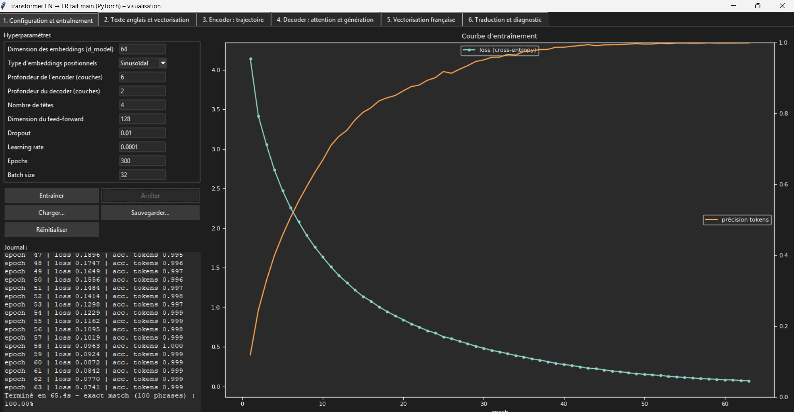
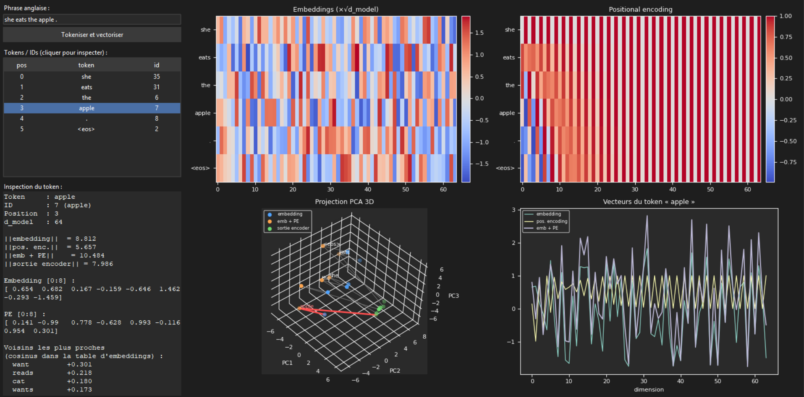
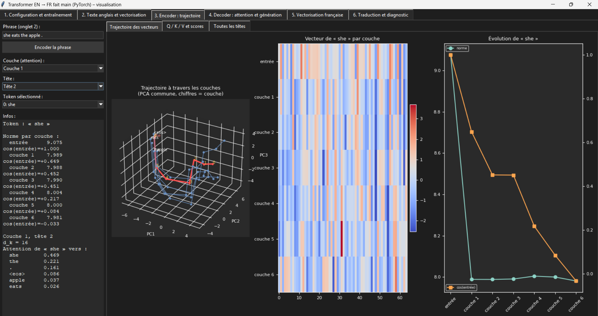
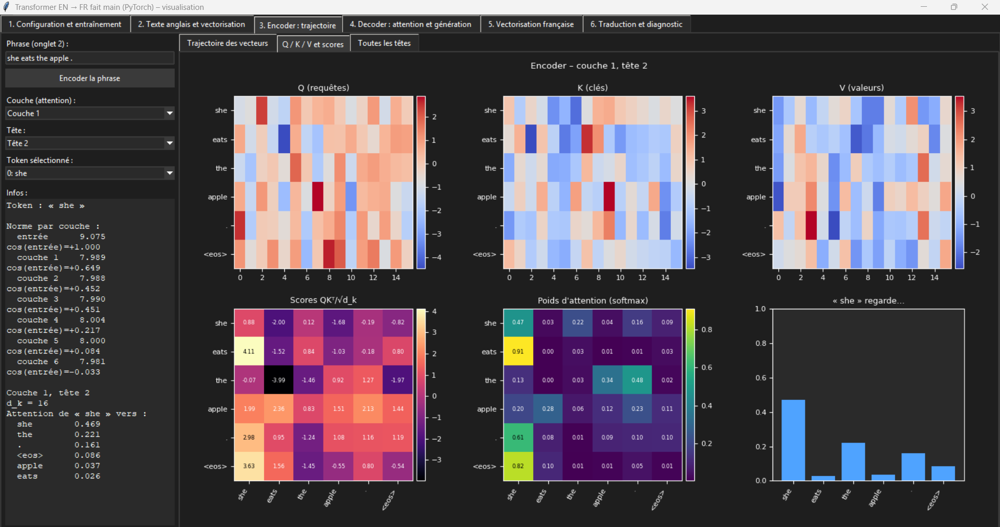
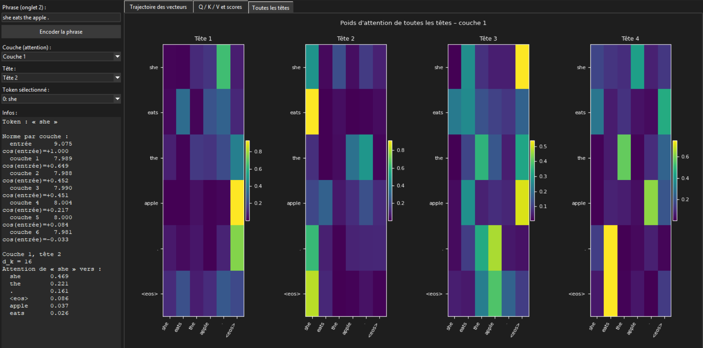
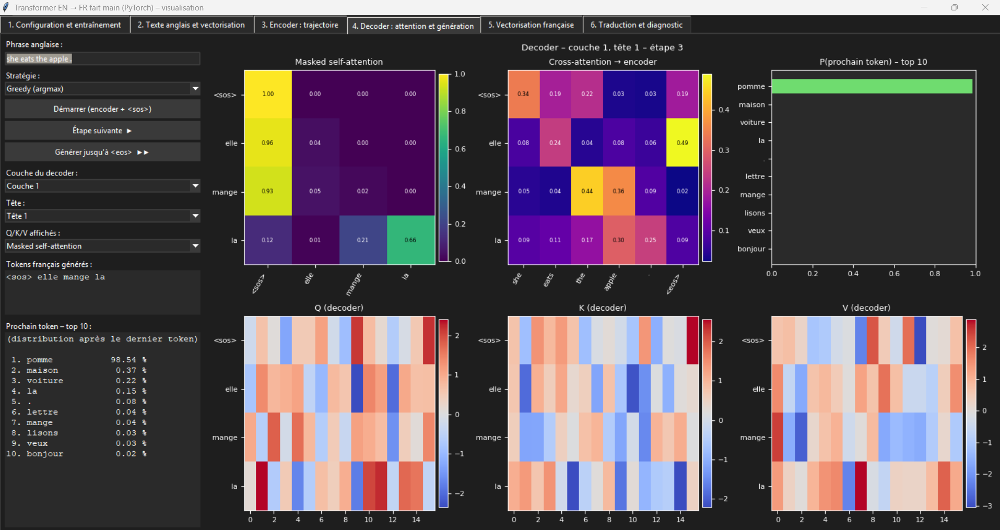
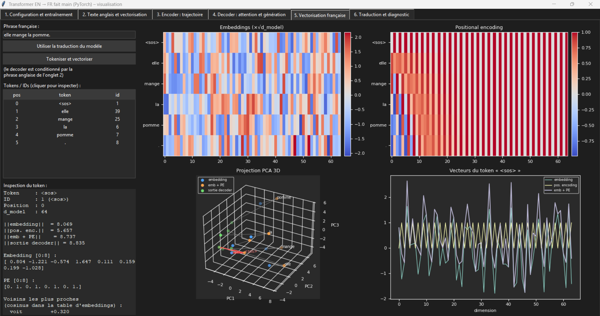
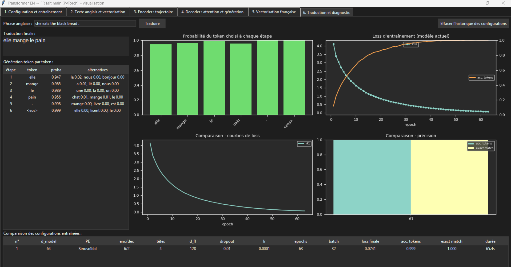

# Transformer EN → FR fait main

Projet d'informatique : un Transformer (encoder-decoder) codé à la main avec PyTorch, et une interface Tkinter pour voir ce qui se passe dedans. Pas de Hugging Face, pas de `nn.Transformer`.

## Lancer

```
pip install -r requirements.txt
python main.py
```

## Interface

1. Configuration et entraînement



2. Texte anglais et vectorisation (embeddings, positional encoding, PCA 3D)



3. Encoder (trajectoire des vecteurs, Q/K/V, attention)





4. Decoder (masked self-attention, cross-attention, génération pas à pas)



5. Vectorisation française



6. Traduction et diagnostic (loss, comparaison de configurations)



## Données

Les phrases viennent de `traduction_.csv` : une paire par ligne (anglais ; français), séparateur `,` ou `;`, en-tête facultatif.

```
en;fr
i see the apple .;je vois la pomme .
she eats a book .;elle mange un livre .
```

Le modèle ne connaît que les mots présents dans le fichier. Pour qu'il apprenne un nouveau mot ou un nouveau verbe, il faut l'ajouter dans plusieurs phrases.

## Fichiers

- `traduction_.csv` : le corpus anglais/français
- `src/model.py` : le Transformer
- `src/data.py` : lecture du csv, tokenisation, vocabulaire
- `src/app.py`, `src/tabs.py`, `src/plots.py` : l'interface
- `src/textes.py` : tous les textes de l'interface
